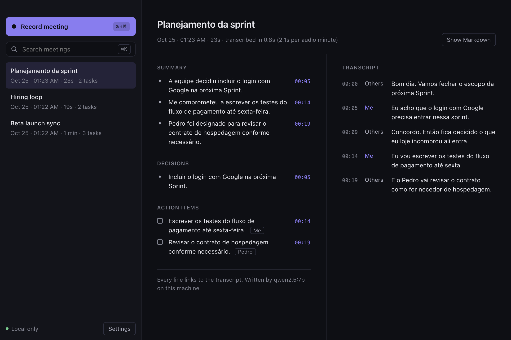

<p align="center">
  
</p>

<h1 align="center">Tacet</h1>

<p align="center">
  Meeting notes that never leave your computer.<br/>
  Records your mic and the call audio, transcribes with whisper.cpp, writes the minutes with a local LLM.
</p>

<p align="center">
  <a href="https://github.com/OwlHugo/tacet/actions/workflows/ci.yml"></a>
  
  
</p>

<p align="center">
  <!-- DEMO GIF: record 20-30 s (press the shortcut, talk, stop, minutes appear), save as docs/demo.gif
       and replace the screenshot below with  -->
  
</p>

## Install

```bash
# Desktop app (tray): download the .dmg, .exe or .AppImage from Releases
open https://github.com/OwlHugo/tacet/releases/latest

# CLI, no install
npx tacet transcribe meeting.wav
```

Requirements: [whisper.cpp](https://github.com/ggml-org/whisper.cpp) (`brew install whisper-cpp` on macOS; Windows and Linux builds ship it) and, for minutes, [Ollama](https://ollama.com) with a model (`ollama pull qwen2.5:7b`). The first run downloads the whisper `base` model (142 MB) from Hugging Face. Run `npx tacet doctor` to check everything.

## Your data stays on your machine

**Nothing leaves your computer.** No account, no server, no telemetry, no analytics.

- Audio is recorded to a local folder and transcribed by a whisper.cpp process on your CPU or GPU.
- Minutes are written by Ollama on `localhost`. The core refuses any Ollama host that is not loopback (`127.0.0.1`, `localhost`, `::1`), so a misconfigured `OLLAMA_HOST` cannot send a transcript to another machine. See [`ollama.ts`](packages/core/src/ollama.ts).
- The only network request Tacet ever makes is the one-time download of public model weights from Hugging Face. It sends nothing about you or your meetings. Put the `.bin` in `~/.cache/whisper` (or set `TACET_MODELS_DIR`) and Tacet never goes online at all.
- Notes are plain Markdown files in a folder you choose. Delete them and they are gone.

## Why

Granola, Otter and Fireflies are good products, but they upload every word of your meetings to someone else's servers. For a lot of people that is a deal breaker: client calls under NDA, health, legal, HR, anything in the EU.

The pieces to do this locally now exist and are fast. whisper.cpp transcribes a minute of audio in about 2 seconds on an M4, and a 7B model on Ollama writes good minutes. What was missing was the glue: capturing the call audio without installing a virtual audio driver, keeping "who said what" without diarization models, and making the LLM output trustworthy.

That last part is the one Tacet takes seriously. **If it is not in the transcript, it is not in the minutes.**

## What it does

- **Two tracks, no driver.** Your microphone and the system audio are recorded as separate files. System audio uses Chromium's loopback capture: ScreenCaptureKit on macOS 13+, WASAPI on Windows, the PulseAudio/PipeWire monitor on Linux. No BlackHole, no Loopback.app.
- **Me / Others.** Each track is transcribed separately, so speaker labels come for free. Mic echo of the speakers is detected and removed when you are not using headphones.
- **Timestamps you can trust.** Whisper's timestamps drift on tracks that are mostly silence. Tacet snaps each segment to the speech it actually covers, getting the error down from seconds to about 10 ms (see the eval).
- **Grounded minutes.** Summary, decisions and action items with owners. Every item cites transcript line ids and quotes the line. A deterministic check then drops anything whose quote is not in the transcript, any owner whose name was never said, and any task whose wording is not supported by its source. Timestamps come from the transcript, never from the model.
- **Obsidian-ready Markdown.** YAML frontmatter, a `^t0003` block id on every transcript line, and every minutes item links to its line: `[[#^t0003|00:14]]`.
- **Search** across every meeting (titles, minutes, transcripts), accent and case insensitive.
- **Global shortcut** `⌘⇧M` / `Ctrl+Shift+M` to start and stop from anywhere.

## Eval

Run on every push, on macOS, Windows and Linux ([`ci.yml`](.github/workflows/ci.yml)). The dataset is three synthetic two-track meetings (two in English, one in Brazilian Portuguese) generated with `say` from scripts with known text, timing and expected action items: [`eval/scripts.json`](eval/scripts.json).

Measured on a MacBook Pro M4, whisper `base`, `qwen2.5:7b` on Ollama:

| Case | Audio | WER | Speaker attribution | Timestamp error | Transcribe (s / audio min) | Minutes (s / audio min) | Grounded items | Expected tasks found |
|---|---|---|---|---|---|---|---|---|
| 01-launch-sync-en | 30.2s | 1.2% | 100.0% | 0.01s | 1.94 | 27.76 | 4/4 | 3/3 |
| 02-hiring-en | 19.4s | 3.4% | 100.0% | 0s | 1.98 | 33.62 | 3/3 | 2/2 |
| 03-planejamento-pt | 22.7s | 15.1% | 100.0% | 0.01s | 1.82 | 27.98 | 2/2 | 1/2 |
| **Total** | 72.3s | **6.2%** | **100%** | | **1.9** | 29.4 | **9/9** | 85.7% |

Hallucination guard: **12/12** fabricated items rejected (four made-up items citing real line ids are injected into every case).

With `large-v3-turbo` the WER drops to **2.7%** (0.0% / 3.4% / 5.7%) at 11.2 s per audio minute.

What the columns mean:

- **WER**: word error rate per track against the script, pooled over all words.
- **Speaker attribution**: share of script lines that land on the right track.
- **Timestamp error**: mean distance between when a line was spoken and the start of the segment holding it.
- **Grounded items**: decisions and action items that cite real lines, carry the timestamp of the first cited line and whose quote is found there. Checked by an independent function ([`grounding.ts`](packages/core/src/eval/grounding.ts)), separate from the guard that filters the output. CI fails if any item is ungrounded or any injected item survives.
- **Expected tasks found**: recall of the action items written in the script. The miss in the Portuguese case is on purpose kept visible: whisper `base` heard "como fornecedor" as "como for necedor", and Tacet would rather drop a task than write one the transcript does not say.

Transcription runs for real on all three CI runners. The LLM outputs are recorded locally (`pnpm eval:record`) and replayed in CI, since GitHub runners have no GPU for a 7B model; the grounding checks run on those outputs every time.

```bash
pnpm eval            # live if Ollama is running, replay otherwise
pnpm eval:record     # re-record the LLM fixtures
node scripts/make-eval.mjs   # regenerate the audio (macOS, uses `say`)
```

## Architecture

```
apps/desktop  Electron tray app (React + Vite)
  main        tray, global shortcut, IPC, setDisplayMediaRequestHandler → audio: 'loopback'
  recorder    hidden window: getUserMedia (mic) + getDisplayMedia (system) → AudioWorklet
              → 16 kHz mono PCM → main process → one WAV per track
  renderer    meeting list, search, minutes next to the transcript

apps/cli      `tacet transcribe | search | list | eval | doctor`

packages/core pure TypeScript, no Electron, published to npm as @tacet/core
  transcribe  spawn whisper.cpp per track → snap to speech → merge, drop mic echo
  minutes     Ollama structured output (JSON schema) → groundMinutes() → Minutes
  markdown    Obsidian Markdown with block ids and timestamp links
  store       folder of .md + .tacet/*.json, search
  eval        WER, grounding check, timing, hallucination guard
```

```
 mic ──► me.wav ─────┐                         ┌──► summary   [[#^t0001|00:04]]
                      ├─► whisper.cpp ─► merge ─┤
 system ► others.wav ─┘   (per track)   + snap  └──► Ollama ─► ground ─► decisions, tasks
                                                     (JSON)    (drop what is not said)
```

Using the core from your own code:

```ts
import { processMeeting } from '@tacet/core';

const { meeting, markdownPath } = await processMeeting({
  tracks: [
    { path: 'me.wav', speaker: 'Me' },
    { path: 'others.wav', speaker: 'Others' },
  ],
  title: 'Weekly sync',
  outputDir: '~/Obsidian/Meetings',
  transcribe: { model: 'large-v3-turbo', language: 'en' },
  minutes: { model: 'qwen2.5:7b' },
});
```

## CLI

```
tacet transcribe <audio...>        one file, or --mic me.wav --system them.wav, or file.wav:Name
  -m, --model base|small|large-v3-turbo|path.bin
  -l, --language en|pt|...|auto
  --llm qwen2.5:7b   --no-minutes   -t "Title"   -o ~/notes   --json
tacet search "pricing page" [--dir ~/notes]
tacet list [--dir ~/notes]
tacet eval [--mode live|replay|off] [--record] [--max-wer 0.15]
tacet doctor
```

## Permissions

- **macOS**: Microphone, and Screen & System Audio Recording (System Settings → Privacy & Security). Screen capture is only used to get the system audio; the video track is stopped the moment it starts and never saved.
- **Windows**: microphone access in Settings → Privacy. System audio needs nothing.
- **Linux**: PulseAudio or PipeWire with `pipewire-pulse`. Tacet records the "Monitor of …" source of your output device.

## Development

```bash
pnpm install
pnpm build && pnpm test
pnpm desktop                    # Electron in dev mode
pnpm e2e                        # records 22 s through the real app and runs the whole pipeline
pnpm dist                       # .dmg / .exe / .AppImage into apps/desktop/release
```

Node 22.18+ and pnpm 10.

## Roadmap

- Live transcript while recording
- Real diarization inside the "Others" track
- Calendar integration to name meetings
- Notarized macOS build and auto-update
- Larger eval set with real, consented recordings

## License

MIT
