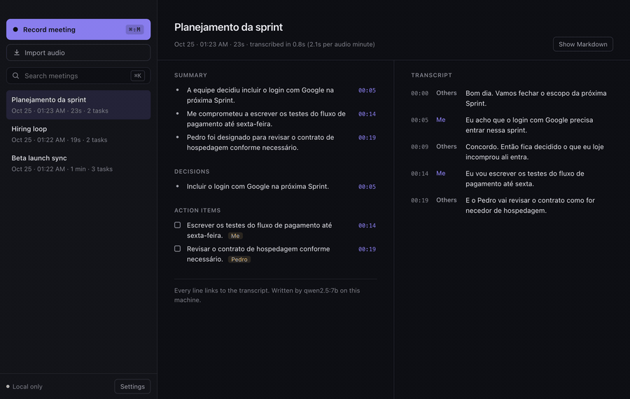

<p align="center">
  
</p>

<h1 align="center">Tacet</h1>

<p align="center">
  Meeting notes that never leave your computer.<br/>
  Records your mic and the call audio, transcribes with whisper.cpp, writes the minutes with a local LLM.
</p>

<p align="center">
  <a href="https://github.com/OwlHugo/tacet/actions/workflows/ci.yml"></a>
  
  
</p>

<p align="center">
  
  <br/>
  <sub>A 67 s meeting (<a href="docs/demo/meeting.wav">docs/demo/meeting.wav</a>) imported on a MacBook Pro M4. The wait for whisper.cpp and the local LLM (about 20 s) is sped up 6×.</sub>
</p>

## Install

```bash
# Desktop app (tray): download the .dmg, .exe or .AppImage from Releases
open https://github.com/OwlHugo/tacet/releases/latest

# CLI, no install
npx tacet transcribe meeting.wav
```

Requirements: [whisper.cpp](https://github.com/ggml-org/whisper.cpp) (`brew install whisper-cpp` on macOS; Windows and Linux builds ship it) and, for minutes, [Ollama](https://ollama.com) with a model (`ollama pull qwen2.5:7b`). Tacet uses the best whisper model already in `~/.cache/whisper` (`large-v3-turbo`, then `small`, then `base`); with none there, the first run downloads `base` (142 MB) from Hugging Face. You can pick another in Settings or with `-m`. Run `npx tacet doctor` to check everything.

## Your data stays on your machine

**Nothing leaves your computer.** No account, no server, no telemetry, no analytics.

- Audio is recorded to a local folder and transcribed by a whisper.cpp process on your CPU or GPU.
- Minutes are written by Ollama on `localhost`. The core refuses any Ollama host that is not loopback (`127.0.0.1`, `localhost`, `::1`), so a misconfigured `OLLAMA_HOST` cannot send a transcript to another machine. See [`ollama.ts`](packages/core/src/ollama/ollama.ts).
- The only network request Tacet ever makes is the one-time download of public model weights from Hugging Face. It sends nothing about you or your meetings. Put the `.bin` in `~/.cache/whisper` (or set `TACET_MODELS_DIR`) and Tacet never goes online at all.
- Notes are plain Markdown files in a folder you choose. Delete them and they are gone.

## Why

Granola, Otter and Fireflies are good products, but they upload every word of your meetings to someone else's servers. For a lot of people that is a deal breaker: client calls under NDA, health, legal, HR, anything in the EU.

The pieces to do this locally now exist and are fast. whisper.cpp transcribes a minute of audio in about 2 seconds on an M4, and a 7B model on Ollama writes good minutes. What was missing was the glue: capturing the call audio without installing a virtual audio driver, keeping "who said what" without diarization models, and making the LLM output trustworthy.

That last part is the one Tacet takes seriously. **If it is not in the transcript, it is not in the minutes.**

## What it does

- **Two tracks, no driver.** Your microphone and the system audio are recorded as separate files. System audio uses Chromium's loopback capture: ScreenCaptureKit on macOS 13+, WASAPI on Windows, the PulseAudio/PipeWire monitor on Linux. No BlackHole, no Loopback.app.
- **Me / Others.** Each track is transcribed separately, so speaker labels come for free. Mic echo of the speakers is detected and removed when you are not using headphones.
- **Timestamps you can trust.** Whisper's timestamps drift on tracks that are mostly silence. Tacet snaps each segment to the speech it actually covers, getting the error down from seconds to about 10 ms (see the eval).
- **Grounded minutes.** Summary, decisions and action items with owners and deadlines. Every item cites transcript line ids and quotes the line. A deterministic check then drops anything whose quote is not in the transcript, any owner whose name was never said, any deadline not said in the task's lines, and any task whose wording is not supported by its source. Timestamps come from the transcript, never from the model.
- **Obsidian-ready Markdown.** YAML frontmatter, a `^t0003` block id on every transcript line, and every minutes item links to its line: `[[#^t0003|00:14]]`.
- **Search** across every meeting (titles, minutes, transcripts), accent and case insensitive.
- **Global shortcut** `⌘⇧M` / `Ctrl+Shift+M` to start and stop from anywhere.
- **Import audio.** Drop a `.wav`, `.m4a` or `.mp3` on the window (or use *Import audio*) to run the same pipeline on a recording you already have. No microphone or screen permission needed. An imported file is one mixed track, so lines are labelled "Speaker" and tasks only get an owner whose name was said.

## Eval

Run on every push, on macOS, Windows and Linux ([`ci.yml`](.github/workflows/ci.yml)). The dataset is three synthetic two-track meetings (two in English, one in Brazilian Portuguese) generated with `say` from scripts with known text, timing and expected action items ([`evals/scripts.json`](evals/scripts.json)), plus the one-track demo meeting as an imported file ([`04-sprint-import-en`](evals/cases/04-sprint-import-en/case.json)), where no line says who spoke.

Measured on a MacBook Pro M4, whisper `base`, `qwen2.5:7b` on Ollama:

| Case | Audio | WER | Speaker attribution | Timestamp error | Transcribe (s / audio min) | Minutes (s / audio min) | Grounded items | Expected tasks found | Deadlines right |
|---|---|---|---|---|---|---|---|---|---|
| 01-launch-sync-en | 30.2s | 1.2% | 100.0% | 0.01s | 1.91 | 26.00 | 4/4 | 3/3 | 3/3 |
| 02-hiring-en | 19.4s | 3.4% | 100.0% | 0.00s | 2.01 | 37.62 | 3/3 | 2/2 | 1/1 |
| 03-planejamento-pt | 22.7s | 15.1% | 100.0% | 0.01s | 1.77 | 35.74 | 3/3 | 1/2 | 0/1 |
| 04-sprint-import-en | 65.9s | 4.1% | – | 0.02s | 1.09 | 17.27 | 4/4 | 3/3 | 2/2 |
| **Total** | 138.2s | **5.2%** | **100%** | | **1.5** | 25.1 | **14/14** | 90.0% | 6/7 |

Hallucination guard: **26/26** fabricated items rejected (four made-up items citing real line ids are injected into every case, and a deadline nobody said is pinned on every real task).

With `large-v3-turbo` (the default when it is downloaded), the WER drops to **3.1%** overall (0.0% / 3.4% / 5.7% / 3.5%) at 7.9 s per audio minute, and the Portuguese case finds both tasks ("como fornecedor" is heard right). Grounded items stay 14/14 and the guard rejects 25/25; deadlines right are 5/7, none wrong.

What the columns mean:

- **WER**: word error rate per track against the script, pooled over all words.
- **Speaker attribution**: share of script lines that land on the right track (two-track cases only; the one-track import has nothing to attribute).
- **Timestamp error**: mean distance between when a line was spoken and the start of the segment holding it.
- **Grounded items**: decisions and action items that cite real lines, carry the timestamp of the first cited line and whose quote is found there; a task's owner must be a track of that meeting, a name that was said, or nobody. Checked by an independent function ([`grounding.ts`](evals/metrics/grounding.ts)), separate from the guard that filters the output. CI fails if any item is ungrounded or any injected item survives.
- **Deadlines right**: deadlines said in the script that reach the right task, in the words that were said. A task carrying a deadline other than the one said, or one the script gives no deadline, fails the eval; a missing one only lowers this count. The miss is the Portuguese case: the model wrote "sexta-feira" where only "sexta" was said, and the guard dropped it.
- **Expected tasks found**: recall of the action items written in the script. The miss in the Portuguese case is on purpose kept visible: whisper `base` heard "como fornecedor" as "como for necedor", and Tacet would rather drop a task than write one the transcript does not say.

Transcription runs for real on all three CI runners. The whisper and LLM outputs are recorded locally (`pnpm eval:gravar`) and replayed in CI, since GitHub runners have no GPU for a 7B model; the grounding checks run on those outputs every time.

```bash
pnpm eval:sem-ia             # replay the recorded outputs (what CI runs on every PR)
pnpm eval                    # real whisper.cpp + Ollama on this machine
pnpm eval:gravar             # same, and re-record evals/cases/*/fixture.json
node evals/gerar-audio.ts    # regenerate the audio (macOS, uses `say`)
```

## Architecture

```
apps/desktop  Electron tray app (React + Vite)
  main        tray, global shortcut, IPC, setDisplayMediaRequestHandler → audio: 'loopback'
  recorder    hidden window: getUserMedia (mic) + getDisplayMedia (system) → AudioWorklet
              → 16 kHz mono PCM → main process → one WAV per track
  renderer    meeting list, search, minutes next to the transcript

apps/cli      `tacet transcribe | search | list | doctor`

packages/core TypeScript, no Electron, published to npm as @tacet/core
  transcript  merge tracks into one timeline, drop mic echo           (pure)
  minutes     prompt, groundMinutes(): drop what is not said          (pure)
  meeting     processMeeting(), Obsidian Markdown, search             (pure)
  whisper     whisper.cpp adapter: spawn per track, snap to speech    (I/O)
  ollama      Ollama adapter: structured output, loopback only        (I/O)
  library     folder of .md + .tacet/*.json                           (I/O)

evals         WER, attribution, timestamp error, grounding check, hallucination guard
```

Ports are plain function types (`TranscribeTrack`, `GenerateRawMinutes`), passed in as
parameters: whisper.cpp and Ollama in the apps, fakes in the tests. `scripts/arquitetura.ts`
fails CI if a pure module imports I/O or an adapter, or if there is an import cycle.

```
 mic ──► me.wav ─────┐                         ┌──► summary   [[#^t0001|00:04]]
                      ├─► whisper.cpp ─► merge ─┤
 system ► others.wav ─┘   (per track)   + snap  └──► Ollama ─► ground ─► decisions, tasks
                                                     (JSON)    (drop what is not said)
```

Using the core from your own code:

```ts
import { ensureModel, MeetingLibrary, ollamaMinutes, processMeeting, whisperTranscriber } from '@tacet/core'

const meeting = await processMeeting(
  {
    id: crypto.randomUUID(),
    title: 'Weekly sync',
    date: new Date(),
    tracks: [
      { path: 'me.wav', speaker: 'Me' },
      { path: 'others.wav', speaker: 'Others' },
    ],
  },
  {
    transcribeTrack: whisperTranscriber({
      bin: '/opt/homebrew/bin/whisper-cli',
      model: await ensureModel('large-v3-turbo', `${process.env.HOME}/.cache/whisper`),
      language: 'en',
      env: process.env,
    }),
    whisperModel: 'large-v3-turbo',
    minutes: { generate: ollamaMinutes({ host: '127.0.0.1:11434', model: 'qwen2.5:7b' }), model: 'qwen2.5:7b' },
    now: () => performance.now(),
  },
)
new MeetingLibrary(`${process.env.HOME}/Obsidian/Meetings`).save(meeting)
```

## CLI

```
tacet transcribe <audio...>        one file, or --mic me.wav --system them.wav, or file.wav:Name
  -m, --model base|small|large-v3-turbo|path.bin
  -l, --language en|pt|...|auto
  --llm qwen2.5:7b   --no-minutes   -t "Title"   -o ~/notes   --json
tacet search "pricing page" [--dir ~/notes]
tacet list [--dir ~/notes]
tacet doctor
```

## Permissions

- **macOS**: Microphone, and Screen & System Audio Recording (System Settings → Privacy & Security). Screen capture is only used to get the system audio; the video track is stopped the moment it starts and never saved.
- **Windows**: microphone access in Settings → Privacy. System audio needs nothing.
- **Linux**: PulseAudio or PipeWire with `pipewire-pulse`. Tacet records the "Monitor of …" source of your output device.

## Known issues (v0.1)

- macOS builds are signed ad-hoc, not notarized: right-click → Open the first time. Local builds keep the identifier `dev.tacet.app`, so permissions granted once survive rebuilds.
- On macOS 14.2+ Electron can use either ScreenCaptureKit or the Core Audio tap for loopback. Tacet uses ScreenCaptureKit by default (it only needs the Screen Recording permission). Set `TACET_CATAP=1` to try the Core Audio tap, which only works from the packaged `.app`.
- If recording or playback hangs on macOS, Core Audio is wedged: `sudo killall coreaudiod` fixes it.

## Development

```bash
pnpm install && pnpm check      # what CI runs: lint, types, architecture, knip, tests, eval
./scripts/verificar.sh          # the same gates plus the build, stopping at the first failure
pnpm tacet transcribe x.wav     # the CLI straight from source (Node runs the .ts directly)
pnpm desktop                    # Electron in dev mode
pnpm e2e                        # records 22 s through the real app and runs the whole pipeline
pnpm dist                       # .dmg / .exe / .AppImage into apps/desktop/release
```

Node 24.12+ and pnpm 10 for development. The published CLI and core run on Node 22.18+.
Rules for contributors and coding agents: [AGENTS.md](AGENTS.md).

## Roadmap

- Live transcript while recording
- Real diarization inside the "Others" track
- Calendar integration to name meetings
- Notarized macOS build and auto-update
- Larger eval set with real, consented recordings

## License

MIT
