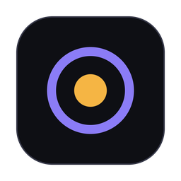
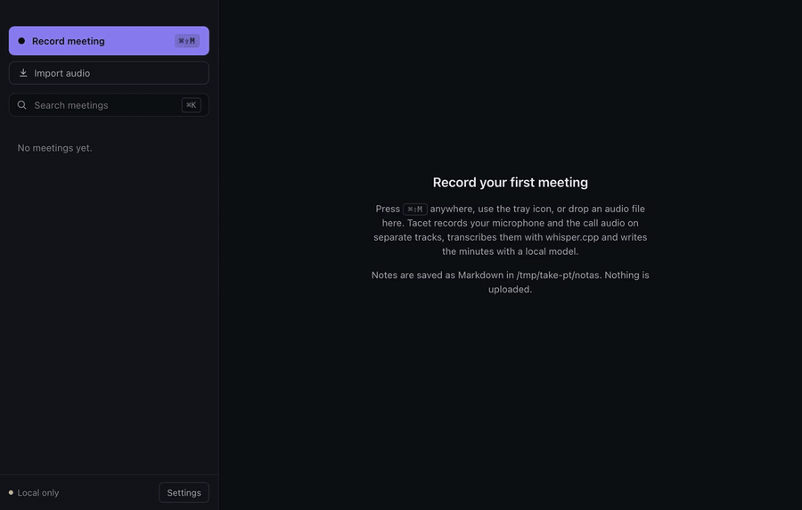

<p align="center">
  
</p>

<h1 align="center">Tacet</h1>

<p align="center">
  Atas de reunião que nunca saem do seu computador.<br/>
  Grava o seu microfone e o áudio da call, transcreve com o whisper.cpp e escreve a ata com um LLM local.
</p>

<p align="center">
  <a href="README.md">English</a> · Português
</p>

<p align="center">
  
  <br/>
  <sub>Call inventada de um minuto, com vozes sintéticas, gravada num MacBook Pro M4. A call roda em 1,5× e a espera pelo whisper.cpp e pelo LLM local (uns 50 s) virou 6 s. Com som: <a href="docs/demo-pt.mp4">docs/demo-pt.mp4</a>.</sub>
</p>

## Instalação

O Tacet usa dois programas que rodam na sua máquina: o whisper.cpp para a transcrição e o Ollama
para a ata. No macOS com [Homebrew](https://brew.sh):

```bash
brew install whisper-cpp ffmpeg     # whisper-cli, e ffmpeg para .m4a / .mp3
brew install ollama                 # ou o app em https://ollama.com/download
ollama serve &                      # pule se o app do Ollama estiver aberto
ollama pull qwen2.5:7b              # 4,7 GB, roda num Mac de 16 GB
```

No Linux, compile o [whisper.cpp](https://github.com/ggml-org/whisper.cpp#quick-start) e deixe o
`whisper-cli` no `PATH` (ou use `TACET_WHISPER_BIN`), instale o ffmpeg pelo gerenciador de pacotes
e o Ollama com `curl -fsSL https://ollama.com/install.sh | sh`. Sem o Ollama, o Tacet salva só a
transcrição.

O Tacet usa o melhor modelo do whisper que já estiver em `~/.cache/whisper`; sem nenhum, a primeira
execução baixa o `base` (142 MB) do Hugging Face.

**App (macOS, Apple Silicon).** Baixe o `Tacet-0.1.0-mac-arm64.dmg` em
[Releases](https://github.com/OwlHugo/tacet/releases) e arraste para Aplicativos. O Tacet fica na
barra de menus.

> **O app não é assinado pela Apple.** O .dmg tem assinatura ad-hoc e não é notarizado, então na
> primeira vez o macOS diz que o Tacet "não pode ser aberto" ou "está danificado". Para abrir, clique
> com o botão direito no Tacet em Aplicativos → Abrir → Abrir (no macOS 15 em diante: tente abrir uma
> vez e vá em Ajustes do Sistema → Privacidade e Segurança → Abrir Mesmo Assim). Ou tire a quarentena
> pelo Terminal:
>
> ```bash
> xattr -dr com.apple.quarantine /Applications/Tacet.app
> ```

**CLI (macOS, Linux; Node 22.18+).** O pacote é `@hugoowl/tacet` (o npm recusou o nome curto por ser
parecido com outros); o comando continua `tacet`.

```bash
npm install -g @hugoowl/tacet
tacet doctor                        # confere whisper.cpp, ffmpeg, modelo e Ollama
tacet transcribe reuniao.m4a
```

**Pelo código** (Node 24.12+ e pnpm 10):

```bash
git clone https://github.com/OwlHugo/tacet && cd tacet
pnpm install
pnpm tacet doctor
pnpm desktop                        # app em modo dev
pnpm dist:mac                       # gera o .dmg em apps/desktop/release
```

Os builds de Windows e Linux estão configurados, mas ainda não foram testados nem publicados.

## Seus dados ficam na sua máquina

**Nada sai do seu computador.** Sem conta, sem servidor, sem telemetria.

- O áudio é gravado numa pasta local e transcrito por um processo do whisper.cpp.
- A ata é escrita pelo Ollama em `localhost`. O core recusa qualquer host do Ollama que não seja loopback, então um `OLLAMA_HOST` errado não manda a transcrição para outra máquina.
- A única requisição de rede é o download, uma vez, dos pesos públicos do modelo no Hugging Face.
- As notas são arquivos Markdown numa pasta que você escolhe.

## O que faz

- **Duas faixas, sem driver.** Microfone e áudio do sistema gravados em arquivos separados, então "Eu" e "Outros" vêm de graça. O eco do microfone é removido quando você não usa fone.
- **Ata ancorada.** Resumo, decisões e tarefas com dono e prazo. Cada item cita as linhas da transcrição; o que não está na transcrição sai da ata, um dono cujo nome nunca foi dito também sai (menos você, quando informa seu nome: veja *Quem é você*), e os horários vêm da transcrição, nunca do modelo.
- **Uma chamada por parte.** Resumo, decisões e tarefas são pedidos separados ao modelo; cada decisão é confirmada nas próprias falas (pergunta, piada ou reclamação não vira decisão) e cada prazo é conferido contra a tarefa dele.
- **Arquivo de uma faixa só.** Importe um `.wav`, `.m4a` ou `.mp3` e ele passa pelo mesmo fluxo.
- **Quem é você.** Nos Ajustes, informe seu nome e apelidos (na CLI, `--me` e `--alias`). Numa gravação, o que for pedido a você vai para a sua faixa "Me"; num arquivo importado, sai com seu nome quando um dos seus nomes foi dito ou a fala te pede algo ("você pode…?", "pode mandar…?", "por favor…"). Um "você" que não é pedido ("te mando o contrato", "obrigado") não te dá tarefa.
- **Seu vocabulário.** Nos Ajustes (ou `--vocab palavras.txt`), liste os nomes e termos que o whisper erra, e ele passa a escrever do seu jeito. A lista fica na sua máquina.
- **Markdown pronto para o Obsidian**, busca em todas as reuniões, atalho global `⌘⇧M` / `Ctrl+Shift+M`.

## CLI

```
tacet transcribe <audio...>        um arquivo, ou --mic eu.wav --system eles.wav
  -m, --model tiny|base|small|large-v3-turbo|caminho.bin
  -l, --language pt|en|...|auto
  --llm qwen2.5:7b   --no-minutes   -t "Título"   -o ~/notas   --json
  --vocab palavras.txt   nomes e termos que o whisper deve esperar, um por linha
  --me Ana --alias Aninha   quem é você: com --mic/--system suas tarefas vão para Me;
                            num arquivo de uma faixa, o que for pedido a você sai com seu nome
tacet search "tela de pedido" [--dir ~/notas]
tacet list [--dir ~/notas]
tacet doctor
```

## Limitações conhecidas (v0.1)

- **Resumo de call longa.** Resumo e decisões são pedidos em pedaços de uns 4000 caracteres, então uma call de 30 minutos pode ganhar muitos pontos de resumo e mais de um "assunto principal". Ainda não são juntados.
- **Horários em call longa e rápida.** O whisper às vezes cola uma fala na anterior da mesma faixa, e essa fala perde o próprio início (uns 6 s de erro médio no caso 05, contra 10 ms nos casos roteirizados).
- **Prazo numa fala que cita duas pessoas.** "A Ana revisa o contrato e o Pedro sobe até sexta": se o modelo devolver só a tarefa da Ana, ela pode ficar com o prazo do Pedro.
- **Suas tarefas num arquivo importado.** Com `--me`, uma tarefa que o modelo te dá num arquivo de uma faixa só fica sua quando um dos seus nomes foi dito ou a fala te pede algo de um jeito conhecido ("você pode revisar…", "pode mandar…?", "por favor…", "can you send…") e o pedido cita palavras da tarefa. Um pedido feito a outra pessoa pelo nome ("Bia, consegue…?", "Pode mandar, Bia?") não é seu, um pedido que o whisper escreveu sem o "?" ("pode mandar o contrato.") não é lido como pedido, e o resto fica sem dono: dono faltando é melhor que dono errado.
- **Prazo numa resposta.** O prazo de uma resposta vai para a tarefa pedida logo antes só quando a resposta não traz mais nada nem um "não": concorda ("Beleza, até sexta") ou assume a tarefa sem outra palavra ("Consigo entregar até sexta"). Qualquer outra palavra pode ser outro trabalho, então "Fechado, faço o deploy até sexta" ou "Beleza, o deploy até sexta" depois de outra tarefa perde o prazo, mesmo quando o deploy é essa tarefa dita com outras palavras, e "Não, até sexta não dá" fica sem prazo.
- **Só o macOS Apple Silicon é gerado e testado.** Windows e Linux estão escritos, mas não foram testados numa máquina de verdade.
- O build do macOS é assinado ad-hoc, sem notarização: na primeira vez, botão direito → Abrir, ou Ajustes do Sistema → Privacidade e Segurança → Abrir Mesmo Assim no macOS 15 em diante, ou `xattr -dr com.apple.quarantine /Applications/Tacet.app` (veja a instalação).

## Desenvolvimento

```bash
pnpm install && pnpm check      # o que o CI roda
./scripts/verificar.sh          # os mesmos gates mais o build
pnpm tacet transcribe x.wav     # a CLI direto do código
pnpm desktop                    # Electron em modo dev
```

Node 24.12+ e pnpm 10. Regras para quem contribui: [AGENTS.md](AGENTS.md) e [CONTRIBUTING.md](CONTRIBUTING.md). O resto da documentação (eval, arquitetura, permissões) está no [README em inglês](README.md).

## Licença

MIT
